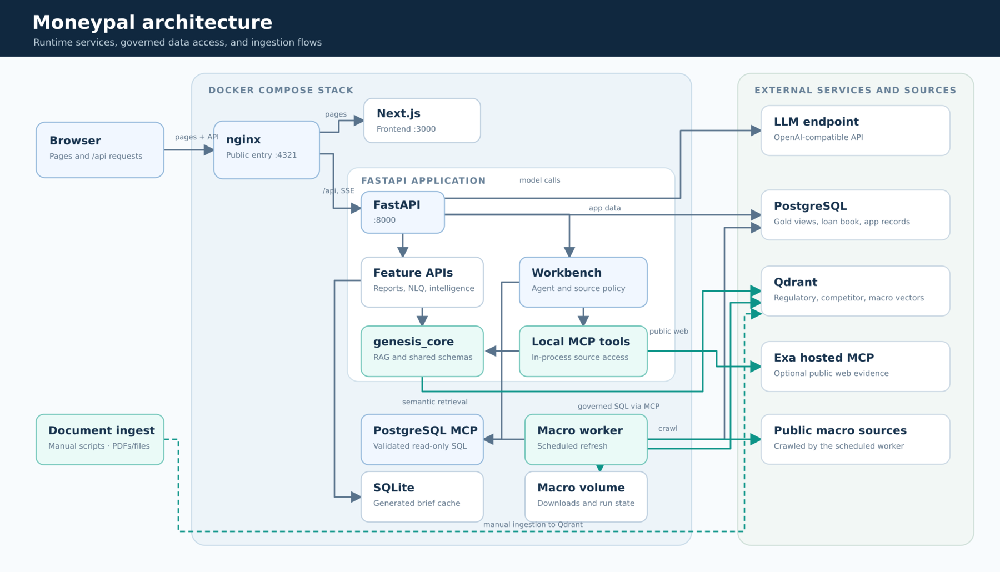
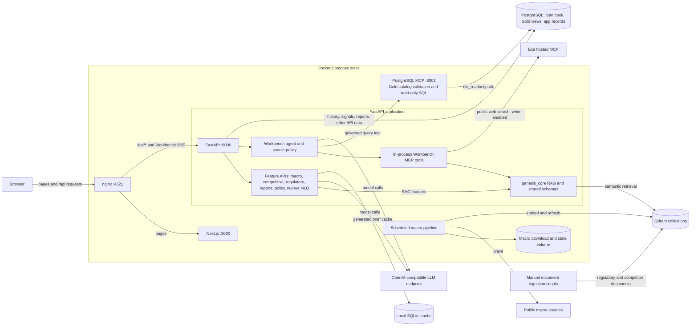

# Moneypal architecture

This diagram shows the Docker Compose deployment and its configured external dependencies. PostgreSQL, Qdrant, the model endpoint, and Exa are not services in `docker-compose.yml`.

The editable Mermaid version is below.

The browser calls `/api/*` on the same origin; nginx strips `/api` before forwarding to FastAPI. The Workbench streams answers through this path. Its local MCP tools run inside the API process, while PostgreSQL queries use the separate MCP container. The macro worker refreshes Qdrant on a schedule; document ingestion scripts populate other collections when run manually.

Sources: `docker-compose.yml`, `nginx/nginx.conf`, `backend/app/main.py`, `backend/app/mcp/`, `backend/app/services/workbench/`, `backend/app/services/brief_cache.py`, and `backend/scripts/macro_pipeline/`.
